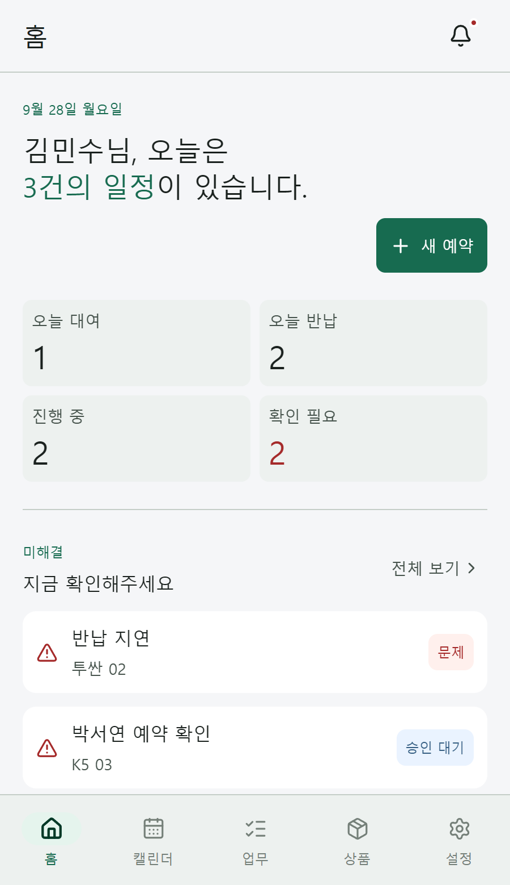
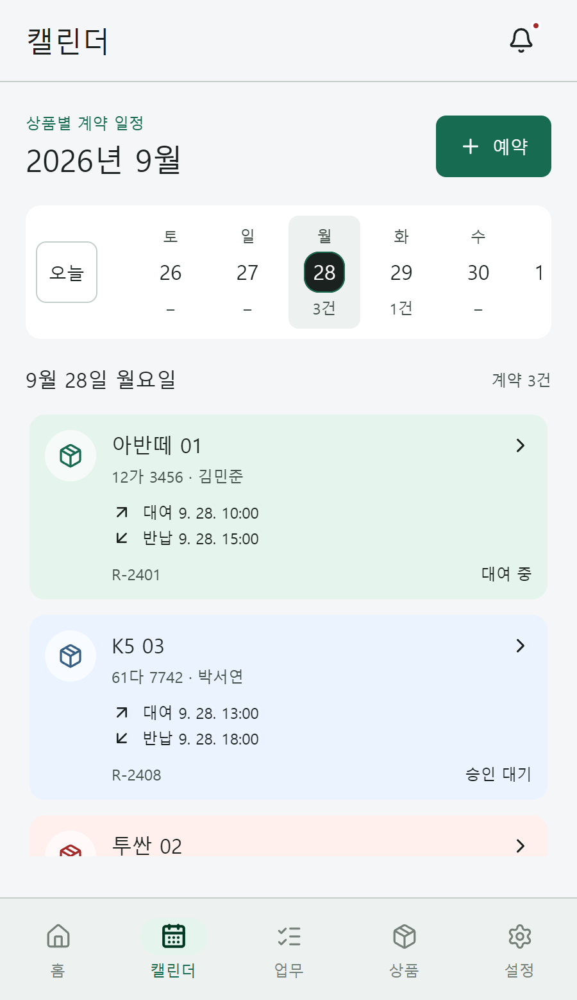
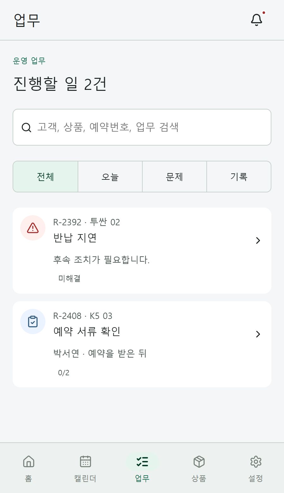
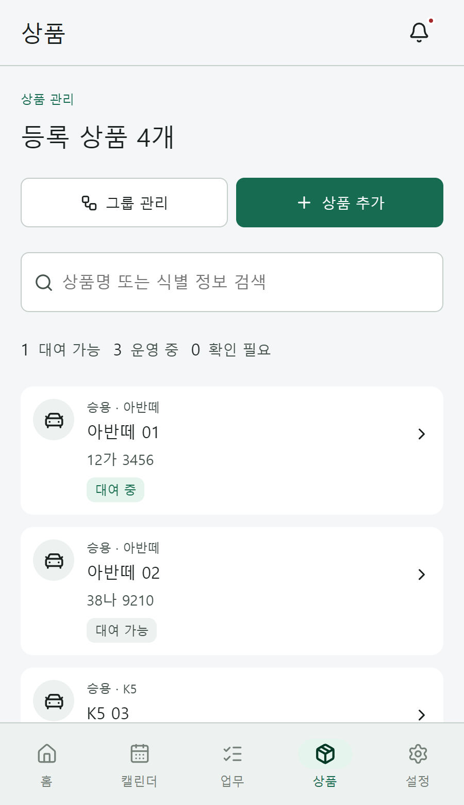
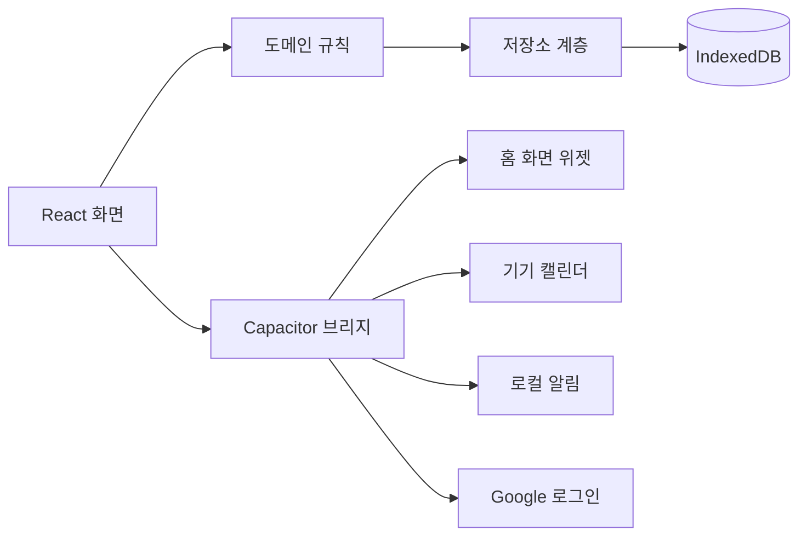

<div align="center">


# Rental Flow

**렌탈 사업자를 위한 로컬 퍼스트 대여·반납 운영 캘린더**

예약, 대여, 반납, 현장 점검 기록을 하나의 흐름으로 관리하는 Android 앱입니다.<br />
업무 데이터는 기기에 저장되며 서버로 전송하지 않습니다. Google 로그인은 선택 사항입니다.

</div>

렌탈 업장에서는 같은 상품에 예약이 겹치지 않는지 확인하고, 대여 직전과 반납 직후의 상태를 빠뜨리지 않고 기록해야 합니다. Rental Flow는 이 두 가지를 한 화면 흐름으로 묶었습니다. 상품 행과 날짜 축이 맞물린 캘린더에서 예약 밀도를 확인하고, 예약을 열어 대여·반납 절차를 진행하며, 점검 항목에 사진과 서명을 남깁니다.

## 스크린샷

| 홈 | 캘린더 |
| :---: | :---: |
|  |  |
| **업무** | **상품** |
|  |  |

## 주요 기능

- **상품별 캘린더** — 상품 열과 날짜 축을 함께 스크롤하는 2축 캘린더입니다. 56일을 렌더링하고 28일 단위로 이동하며, 예약 막대의 길이가 실제 대여 기간을 따릅니다.
- **예약과 승인** — 예약 생성, 승인 대기·보완 요청·승인·거절과 대여 상태(예약·대여 중·반납 중·반납 완료·취소)를 따로 관리합니다.
- **대여·반납 절차** — 상품 그룹마다 절차를 만들고 예약 확정, 대여 2시간 전, 반납 2시간 전, 수동 실행에 연결합니다. 체크, 메모, 숫자, 사진, 서명, 선택형 항목을 지원하고, 결과에 따라 보류·예약 취소·대여 가능 전환·문제 등록으로 분기합니다.
- **업무 보드** — 오늘 할 일, 미해결 문제, 완료 기록을 한 목록에서 검색하고 필터링합니다. 반납 지연과 승인 대기처럼 먼저 볼 일을 위로 올립니다.
- **상품과 그룹** — 카테고리, 그룹, 개별 상품을 등록하고 그룹별 사용자 정의 필드와 상태(대여 가능·예약됨·대여 중·점검·사용 불가)를 관리합니다.
- **홈 대시보드** — 오늘 대여·반납 수, 진행 중인 업무, 확인이 필요한 항목을 한눈에 보여줍니다.
- **홈 화면 위젯** — Android 네이티브 위젯에서 오늘의 대여·반납을 확인하고 앱의 해당 화면으로 바로 이동합니다.
- **로컬 알림** — 대여·반납 2시간 전에 기기 알림을 예약합니다.
- **기기 캘린더 연동** — 선택한 캘린더에 예약 일정을 만들고 갱신합니다. 일정 제목은 상품명과 예약 참조 번호로 구성되며 고객 정보는 포함하지 않습니다.
- **백업과 복원** — 사업장 데이터를 JSON으로 내보내고 다시 가져올 수 있습니다. 가져오기 전에 형식과 버전을 검증합니다.
- **6개 언어** — 한국어, English, Bahasa Indonesia, Tiếng Việt, ภาษาไทย, Bahasa Melayu를 지원합니다. 기기 언어를 따르거나 앱에서 직접 선택할 수 있습니다.
- **로컬 퍼스트** — 업무 데이터는 IndexedDB와 기기 저장소에 남습니다. 네트워크가 없어도 예약과 절차를 그대로 사용할 수 있습니다.

## 기술 스택

| 영역 | 사용 |
| --- | --- |
| UI | React 19, TypeScript, Vite 8 |
| 앱 셸 | Capacitor 8 (Android) |
| 저장 | IndexedDB, 기기 파일 저장소 |
| 네이티브 | Java — App Widget, CalendarContract, Credential Manager |
| 인증(선택) | Google Sign-In, Firebase Authentication REST |
| 디자인 | Material 3 역할 기반 CSS 토큰, Lucide 아이콘 |

## 동작 방식



화면은 도메인 규칙을 거쳐 저장소에 접근하고, 저장소는 스냅샷 검증과 마이그레이션을 담당합니다. 절차 진행, 예약 상태 전이, 반납 지연 판정 같은 규칙은 UI와 분리되어 있어 단위 테스트로 확인합니다. 위젯·캘린더·알림은 Capacitor 플러그인으로 분리되어 있고, 웹 빌드에서는 안전하게 아무 동작도 하지 않습니다.

## 시작하기

Node.js 22 이상과 pnpm 11이 필요합니다.

```bash
pnpm install
pnpm dev
```

개발 서버는 `http://127.0.0.1:4175`에서 실행됩니다.

```bash
pnpm test    # 도메인·저장소·i18n 단위 테스트
pnpm check   # 테스트와 디버그·배포 빌드
pnpm build   # 배포 빌드
```

Android 앱은 JDK 21과 Android SDK가 필요합니다.

```bash
pnpm android:sync
npx cap open android
```

릴리스 서명은 `android/keystore.properties.example`을 참고해 `android/keystore.properties`를 만든 뒤 Android 프로젝트에서 `gradlew.bat bundleRelease`로 진행합니다.

Google 로그인은 선택 사항입니다. `.env.example`을 `.env.local`로 복사하고 Firebase 웹 앱 값을 채우면 로그인 화면이 활성화됩니다. 값이 없으면 로그인 없이 기기 전용 모드로 실행됩니다.

## 프로젝트 구조

```text
.
├─ src/
│  ├─ App.tsx            화면 셸, 내비게이션, 화면 조립
│  ├─ domain.ts          예약·대여·절차 도메인 규칙
│  ├─ model.ts           데이터 모델과 상태 정의
│  ├─ repository.ts      저장소 파사드
│  ├─ local-store.ts     IndexedDB 스냅샷과 마이그레이션
│  ├─ account.ts         내보내기·가져오기·기기 데이터 삭제
│  ├─ i18n/              6개 언어 사전과 포맷터
│  └─ *.css              디자인 토큰과 화면 스타일
├─ android/              Capacitor Android 프로젝트와 네이티브 플러그인
├─ public/               브랜드 마크와 정책 페이지
├─ docs/screenshots/     README 스크린샷
└─ DESIGN-SYSTEM.md      간격·타이포·색 역할 규칙
```

## 데이터와 개인정보

- 사업장, 상품, 예약, 고객 연락처, 메모, 사진은 기기 안에만 저장됩니다.
- JSON 내보내기는 업무 데이터만 담고 사진 원본은 포함하지 않습니다.
- 기기 캘린더 연동은 상품명, 예약 참조 번호, 시작·종료 시각만 사용합니다. 고객 이름, 연락처, 메모, 금액은 보내지 않습니다.
- 광고 SDK, 분석 도구, 위치 추적을 사용하지 않습니다.
- Google 로그인을 켠 경우 인증에 필요한 계정 정보만 Firebase Authentication으로 전송됩니다.
- 설정에서 계정 삭제와 기기 데이터 삭제를 제공합니다.

정책 문서는 `public/privacy.html`, `public/terms.html`, `public/delete-account.html`에 있습니다.

## 테스트

`pnpm test`는 도메인 규칙, 스냅샷 검증과 마이그레이션, 인증 토큰 파싱, 알림 스케줄, 저장소 규칙, 6개 언어 사전, 시간대와 DST, 운영 집계, 캘린더 전송 데이터의 프라이버시를 확인합니다. CI는 같은 검사와 디버그·배포 빌드를 함께 실행합니다.

## 디자인

Material 3의 색 역할과 타이포 스케일을 CSS 토큰으로 옮겼습니다. 8px 그리드, 20px 화면 여백, 48px 최소 터치 영역, 56px 입력 높이를 기준으로 하고, 큰 글자 설정에서도 레이아웃이 무너지지 않도록 rem 단위를 사용합니다. 상세 규칙은 [`DESIGN-SYSTEM.md`](DESIGN-SYSTEM.md)에 정리했습니다.

## 라이선스

© 2026 Rental Flow. 모든 권리는 저작권자에게 있습니다.

## English

Rental Flow is a local-first Android app for rental shops. It combines a product-based booking calendar, approval and rental states, check-in and check-out procedures with photos and signatures, an operations board, a home-screen widget, local reminders, and device calendar sync. Business data stays on the device.

Built with React 19, TypeScript, Vite, Capacitor, and Java native plugins. Run `pnpm install`, then `pnpm dev` (port 4175) or `pnpm test`. Google sign-in is optional; without Firebase values the app runs in on-device mode.
